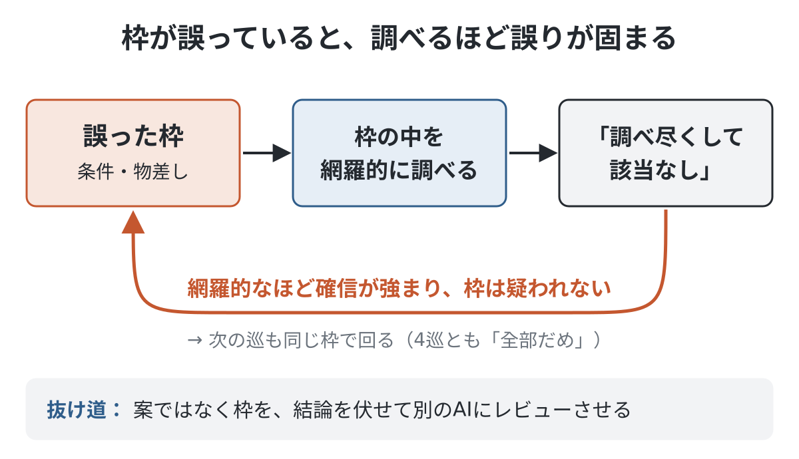
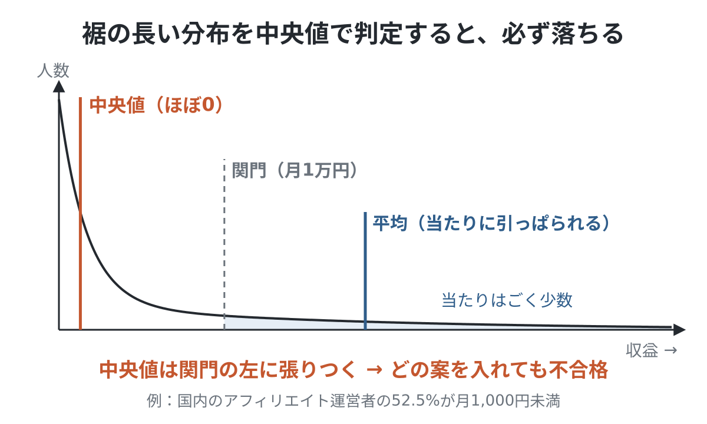
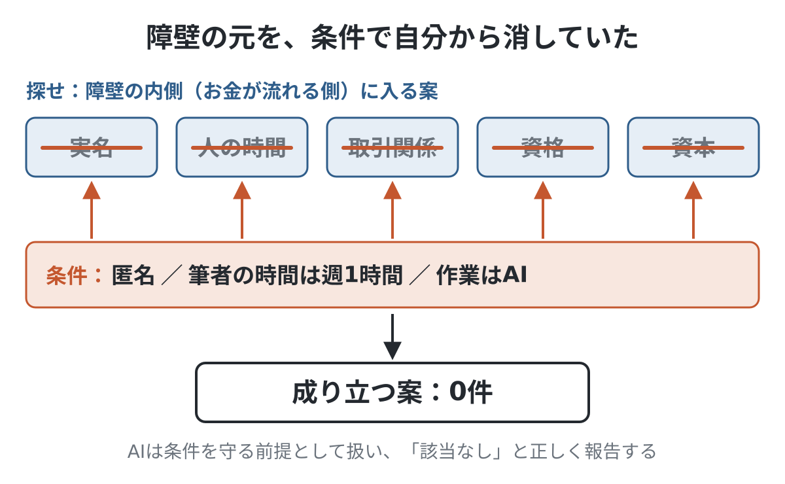
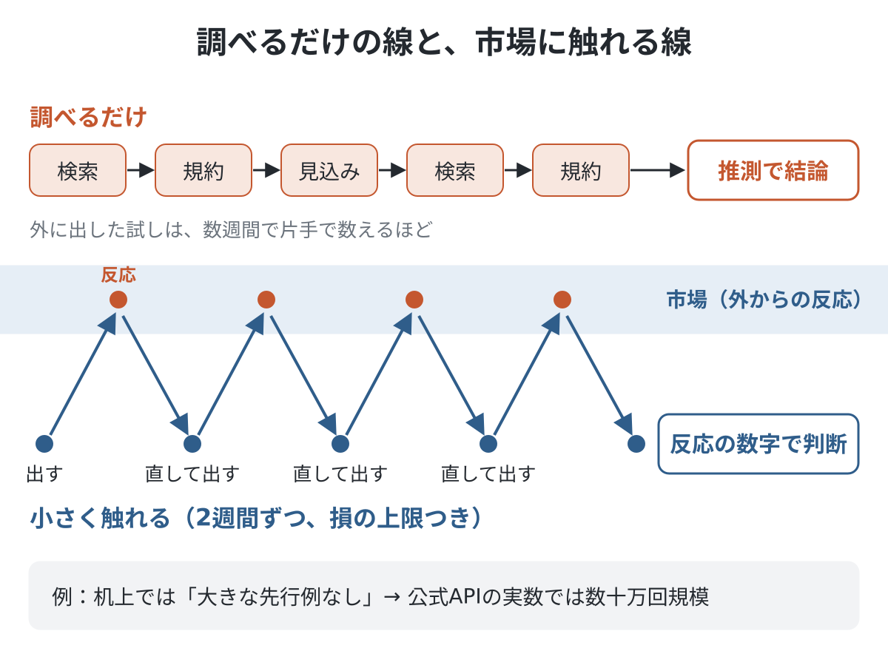
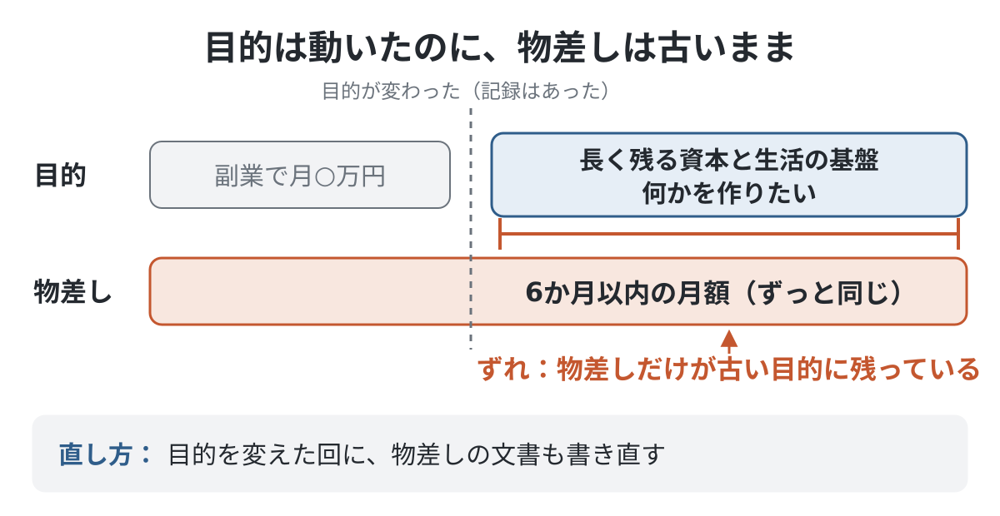

## 結論

AIエージェントに「やる価値のある副業を探して」と頼み、数週間かけて何巡も回しました。結果は毎回「全部だめ」でした。後から独立したレビューにかけると、原因は案の質ではなく、探索の枠の側にありました。

AIは与えられた枠の中で手を抜かずに調べます。そのため枠が誤っていると、誤りがそのまま「調べ尽くした上での結論」になり、網羅的であるほど強く裏付けられてしまいます。陥っていた型は次の4つです。

1. 右に裾の長い賭けを、中央値で判定していた
2. 参入障壁になる要素を、自分の条件で先に消していた
3. 市場に触れず、机の上の調査で終わっていた
4. 目的と判定の物差しがずれていた

どれもAIのせいではなく、依頼した側（筆者）の設計の失敗です。

## 背景

探索では、案を見る前に6つの関門を決め、AIエージェント（Claude Code）が出した案を1件ずつ判定しました（15案の中身は後の記事で書きます）。関門の1つ目は「中央値の期待収益が、6か月以内に月1万円以上」です。厳しく、誤魔化しのきかない基準のつもりでした。

3巡を終えた時点のまとめは「関門を全部通った案は0件。月1万円の中央値に届くのは本業の年収だけ」でした。4巡目でも同じ結論が出たので、案ではなく探索のやり方そのものを、別のエージェントにレビューさせました。渡したのは探索の記録だけで、筆者の結論は伏せています。以下はそのレビューを筆者が整理したものです。

## 型1：裾の長い賭けを中央値で判定する

発信、アプリ、小さな製品のように、結果の分布が右に長く伸びるものは、中央値がほぼ0になるのが普通です。参考になる基準率はいくつもあります。

- 国内のアフィリエイト運営者は、月1,000円未満が52.5%（[日本アフィリエイト協議会の調査](https://www.dreamnews.jp/press/0000353074)、2025年12月、1,000人。一次）
- 決済を連携して収益を確かめた個人の製品でも、58.4%がMRR $0（[Tech Startups](https://techstartups.com/2026/09/28/what-percentage-of-indie-hacker-products-make-100k-in-arr/)、二次。ただし0 MRR のうち1,222件は30日以内に入金あり＝同記事の注記）
- 世界のクリエイター約5,000万人のうち、年10万ドル以上は約4%（[Goldman Sachs](https://www.goldmansachs.com/insights/articles/the-creator-economy-could-approach-half-a-trillion-dollars-by-2027)）

このような分布を中央値で判定すると、新しく始めることは必ず落ちます。判定する前から答えが決まっているので、探索に意味がありません。実際、筆者の記録では関門を厳しくするほど全部が落ちました。

**直し方**：中央値で判定するのは、資本を入れる案（事業を買う等）だけにしました。発信や制作の案は、代わりに次の4つで見ます。

- 最悪の損に上限があるか
- 2週間ごとに外からの反応を測れるか
- 筆者が続けたいと思えるか
- 期間が終わっても記録が残るか

あわせて、案ごとに「一度に置く損の上限」と「当たったときに何倍になるか」を書かせます。悲観的な見方は「やめる基準」の側で持つことにして、入口では落としません。

## 型2：障壁の元を、自分の条件で消す

探索の途中で「お金が安定して流れているのは参入障壁の内側だ」という結論に達しました。障壁の元は、実名、人の時間、取引関係、資格、資本です。

ところが探索の条件は「匿名」「筆者の時間は週1時間」「作業はAI」でした。障壁の元を、条件の段階で自分から全部外していたことになります。「障壁の側に入る案を探せ」と「障壁の元は使わない」を同時に命じていたので、どの案も成り立ちません。

AIはこの矛盾を自分からは指摘しませんでした。条件は守るべき前提として扱われ、その中で最善の調査をした結果「該当なし」と報告されます。報告自体は正しいので、受け取る側も矛盾に気づきにくくなります。

**直し方**：条件を「守る前提」と「緩められる前提」に分けて書き、緩めた場合に探索の天井がどこまで上がるかをAIに見積もらせる。そのうえで、どこまで緩めるかは筆者が決めます。

## 型3：市場に触れず、机上の調査で終わる

**直し方（手順）**：

1. 先行例の数字は、検索の要約ではなく、公式のAPIや一覧から実数で取る
2. 取るときは必ず2通り取る。人気順の上位（成功例の天井）と、新しい順（基準率）
3. 判断に使うのは新しい順の中央値。上位の数字は「当たればここまで」の参考にとどめる
4. 調べ物は最初の小さな試しを出すまでの手段とし、試しは「2週間・損の上限が決まっている・外からの反応が数字で返る」ものにする

数週間の探索で、外に出した試しは片手で数えるほどでした。ほとんどの時間は、先行例の検索、規約の確認、見込みの計算に使われています。

机上の調査が誤っていた例があります。ある巡で、ある2つの企画について、日本語では大きな先行例が見つからない、と結論していました。後日、動画サイトの公式APIで実数を取り直すと、どちらも数十万回規模の動画が並んでいました。検索の要約を読むやり方では見落とし、実数を取ると一度で覆りました。

ただし、実数にも偏りがあります。再生数の多い順に上位25本を取ると、成功した動画だけが並ぶので、中央値も上振れします。そこで「投稿日の新しい順に50本」も取りました。この取り方だと中央値は約1,200回で、上位25本の中央値とは桁が違いました。手順の2を入れたのはこのためです。

## 型4：目的と判定の物差しがずれる

探索の途中で、筆者の目的は「副業で月○万円」から「長く残る資本と生活の基盤を持つこと」「何かを作りたい」へと変わっていました。それなのに判定は「6か月以内の月額」のままで、物差しだけが古い目的に残っていました。

これは定期的な振り返りで見つかりました。筆者は次の決まりで総括を書かせています。

- いつ：前回から7日、区切り（公開開始・一定本数ごと）、大きな手間をかける前、筆者が求めたとき
- 順番：①目的とのつながり ②進み具合（事実と数字） ③効いた点・効かない点 ④続ける／変える／やめると、その根拠とAIの勧め ⑤筆者が決めること
- 場所：振り返り用のファイルの末尾に追記し、進捗ファイルの先頭に最新の結論を1行

①を毎回書かせると、目的が動いたことに気づけます。ただし今回は、目的が動いたことは記録されていたのに、判定の物差しを書いた文書までは更新されていませんでした。目的の変更を、関連する文書に連動させる手順がなかったのが穴です。

**直し方**：目的を変えたら、判定の物差しを書いた文書も同じ回で書き直す。総括の③に「判定の物差しは今の目的に合っているか」を1行加えました。

## 4つに共通すること

4つとも、判定の枠を作ったのは筆者で、AIはその枠の中で誠実に作業しました。枠が誤っていると、誠実で網羅的な作業ほど、誤った結論を強く裏付けてしまいます。

そのため、次の2つを運用に入れました。

- 何巡も同じ結論が出たら、案ではなく枠をレビューにかける。レビュー役には記録だけを渡し、こちらの結論や過去の点数は渡さない
- 枠のレビューの観点を固定する：分布の形と判定の統計量が合っているか／条件が目的と矛盾していないか／外に出した試しの数／目的と物差しの日付が揃っているか

## まだ分からないこと

- 直したやり方で結果が出るかは、まだ分かりません。物差しを緩めたことで、甘い案を通してしまう危険は増えています。その分は「やめる基準」で受けるつもりですが、基準が守られるかどうかは今後の記録で示すしかありません
- 4つの型は1人分の探索から出したもので、一般化できるかは確かめていません
- 次の記事では、同じAIエージェントに「AIで稼いだ」という話の真偽を一次情報で確かめさせた結果を書きます
